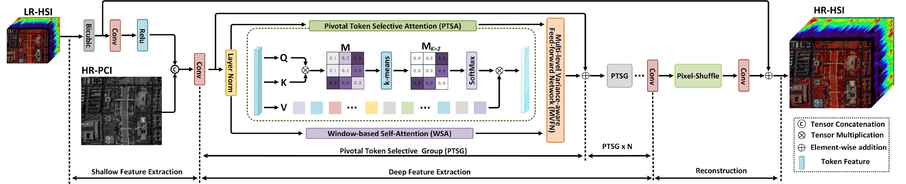
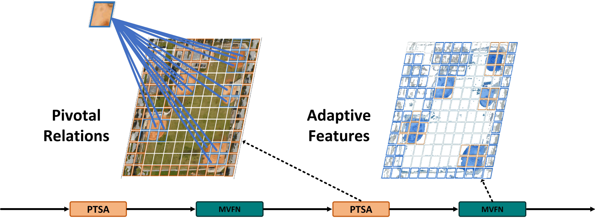
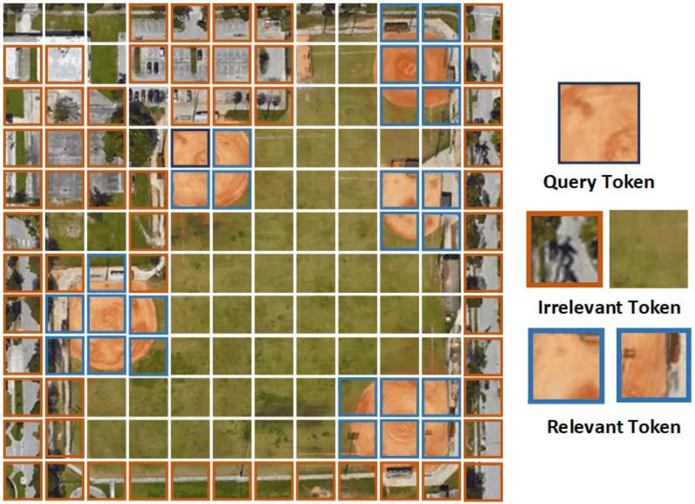
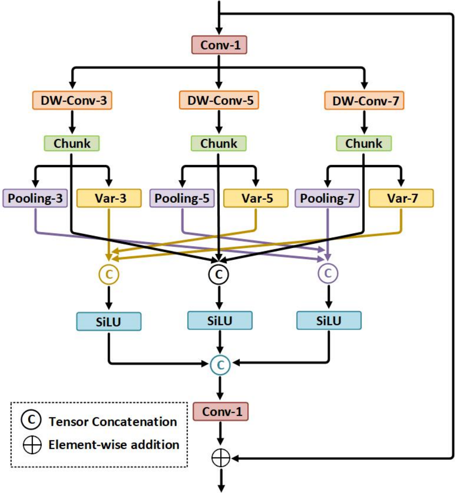
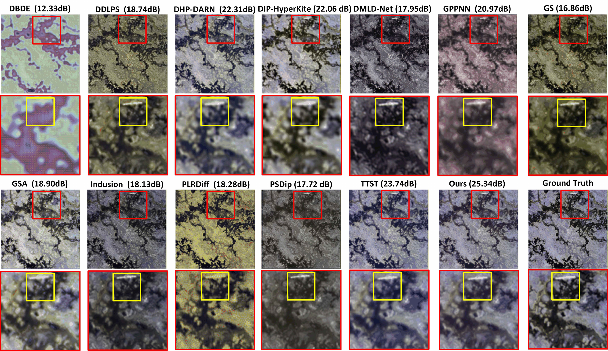
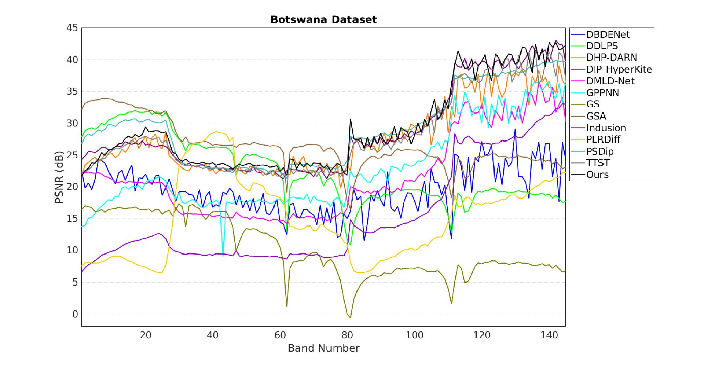
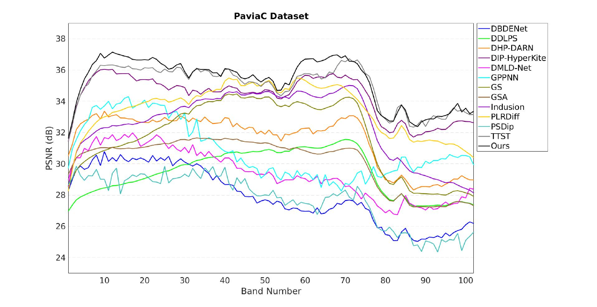
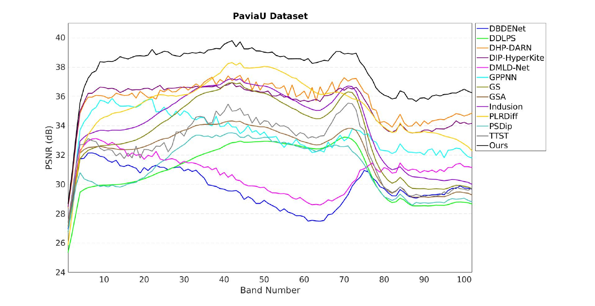

# THAT

**Token-wise High-frequency Augmentation Transformer for Hyperspectral Pansharpening**

[Paper](https://doi.org/10.1109/SMC58881.2025.11343459) · [Data preparation](docs/data.md) · [Implementation notes](docs/reproducibility.md)

THAT reconstructs high-resolution hyperspectral imagery from a low-resolution hyperspectral image and a high-resolution panchromatic image. It combines **Pivotal Token Selective Attention (PTSA)** with a **Multi-level Variance-aware Feed-forward Network (MVFN)** to model spectral–spatial relationships and recover fine image structure.

PyTorch implementation with data preparation, training, and evaluation for ×2, ×4, and ×8 hyperspectral pansharpening.

## Architecture



*Overview of THAT: shallow feature extraction, stacked PTSG modules, and residual reconstruction.*

Each PTSG applies layer normalization, parallel PTSA and window-based self-attention, MVFN fusion, and a residual connection. MVFN combines multi-scale depthwise convolutions, local variance, and pooling branches.

## Method visualization



*Pivotal relations and adaptive feature extraction through PTSA and MVFN.*

<details>
<summary><strong>PTSA token selection and MVFN structure</strong></summary>

### Pivotal Token Selective Attention



*Query tokens and their relevant and irrelevant counterparts.*

### Multi-level Variance-aware Feed-forward Network

<p align="center">
  
</p>

*Multi-scale 3 × 3, 5 × 5, and 7 × 7 branches combine direct features, local variance, and pooling before feature projection and residual fusion.*

</details>

## Results visualization

Results reported in the **SMC 2025 paper**.

### Qualitative comparison: Botswana ×2



*Botswana ×2 reconstruction results and enlarged regions. THAT is labeled “Ours”; ground truth appears in the final column.*

### Band-wise reconstruction quality

| Botswana ×2 | PaviaC ×2 | PaviaU ×2 |
|:---:|:---:|:---:|
| [](assets/figures/botswana-x2-band-psnr.png) | [](assets/figures/paviac-x2-band-psnr.png) | [](assets/figures/paviau-x2-band-psnr.png) |

*Band-wise PSNR on Botswana, PaviaC, and PaviaU at ×2 scaling. Click a plot to view it at full resolution.*

See the [figure gallery](docs/visualizations.md) for full-size visualizations.

## Installation

Python 3.8 or later and PyTorch 2.2 or later are required. Install the appropriate PyTorch build for your CPU or CUDA environment, then run from the repository root:

```bash
python -m pip install -e .
```

For development:

```bash
python -m pip install -e ".[dev]"
```

## Quick start

Run a small synthetic experiment to check data preparation, training, checkpoint loading, and evaluation:

```bash
python examples/smoke_pipeline.py --output-dir runs/smoke
```

The example runs one epoch on synthetic 16 × 16 targets and saves a checkpoint and evaluation report.

To check the model interface with random inputs:

```python
import torch
from that import THAT

model = THAT(in_ch=145, factor=4).eval()
ms = torch.rand(1, 145, 8, 8)
pan = torch.rand(1, 1, 32, 32)

with torch.no_grad():
    prediction = model(ms, pan)  # [1, 145, 32, 32]
```

## Data preparation

Input scenes are MATLAB files containing an H × W × S hyperspectral cube. Prepare independent scenes into separate training, validation, and test directories:

```bash
that-prepare --input scene.mat --key cube \
  --output data/train/scene_x4.mat --factor 4 \
  --visible-bands <comma-separated-indices> --sigma <gaussian-sigma>
```

Set the zero-based visible-band indices and Gaussian standard deviation for your sensor and degradation protocol. The command saves `LRMS`, `PAN`, `HRMS`, and processing metadata. See [data preparation](docs/data.md) for array shapes and split requirements.

## Training

```bash
that-train --data data/train --val-data data/val \
  --bands 145 --factor 4 --num-groups 3 \
  --output runs/botswana_x4.pt
```

| Setting | Default |
|---|---:|
| Transformer width / attention heads | 180 / 6 |
| Epochs / batch size | 50 / 2 |
| Optimizer / learning rate | Adam / 5 × 10⁻⁴ |
| Weight decay | 0 |
| Learning-rate schedule | ×0.5 every 20 epochs |
| Loss | L1 |
| PTSG count / window size | 3 / 8 |

Validation PSNR selects the best checkpoint. The last checkpoint and epoch history are saved alongside it. Use `--device` to select CPU or CUDA and `--seed` to set the training seed. Architecture defaults and their relationship to the paper are documented in [implementation notes](docs/reproducibility.md).

Pretrained checkpoints are not currently released.

## Evaluation

```bash
that-evaluate --checkpoint runs/botswana_x4.pt \
  --data data/test \
  --output runs/botswana_x4_test.json
```

Reports per-image **PSNR, SSIM, SAM, ERGAS, and SCC**, together with their averages across test images. Use `--clip` to clamp predictions to [0, 1] before evaluation. See the [metric definitions](docs/reproducibility.md#evaluation-metrics) for details.

## Development

```bash
python -m pytest -q
python -m black --check src tests examples
```

Tests cover attention masking, batch independence, branch routing, gradient flow, multi-scale outputs, analytical metric values, data degradation, and split leakage. GitHub Actions runs formatting checks, tests, and CLI checks on Python 3.10 and 3.11.

## Repository layout

```text
src/that/
├── model.py          # THAT, PTSA, MVFN, and window attention
├── data.py           # MAT datasets and split checks
├── metrics.py        # Reduced-resolution evaluation metrics
└── cli/              # Data preparation, training, and evaluation
assets/figures/       # Paper architecture and result figures
examples/             # Self-contained synthetic experiment
tests/                # Regression and numerical checks
docs/                 # Data format and reproducibility notes
```

## Citation

```bibtex
@inproceedings{jin2025that,
  title     = {THAT: Token-wise High-frequency Augmentation Transformer for Hyperspectral Pansharpening},
  author    = {Jin, Hongkun and Jiang, Hongcheng and Zhang, Zejun and Zhang, Yuan and Fu, Jia and Li, Tingfeng and Luo, Kai},
  booktitle = {2025 IEEE International Conference on Systems, Man, and Cybernetics (SMC)},
  year      = {2025},
  pages     = {6627--6634},
  doi       = {10.1109/SMC58881.2025.11343459}
}
```

## Acknowledgments

The attention components build on DRSformer and HAT/TTST. Attribution and licensing information are recorded in [NOTICE](NOTICE).
