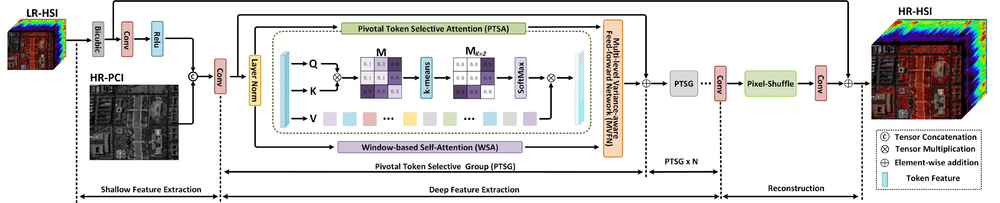
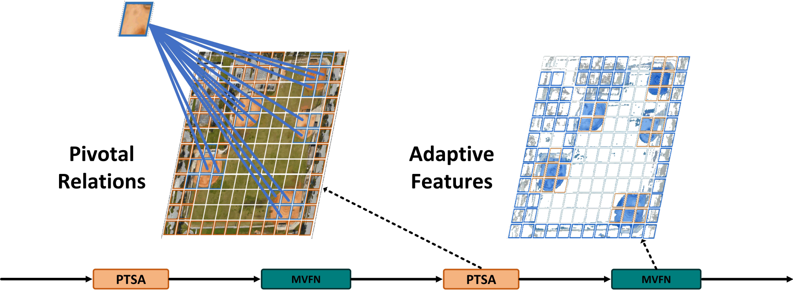
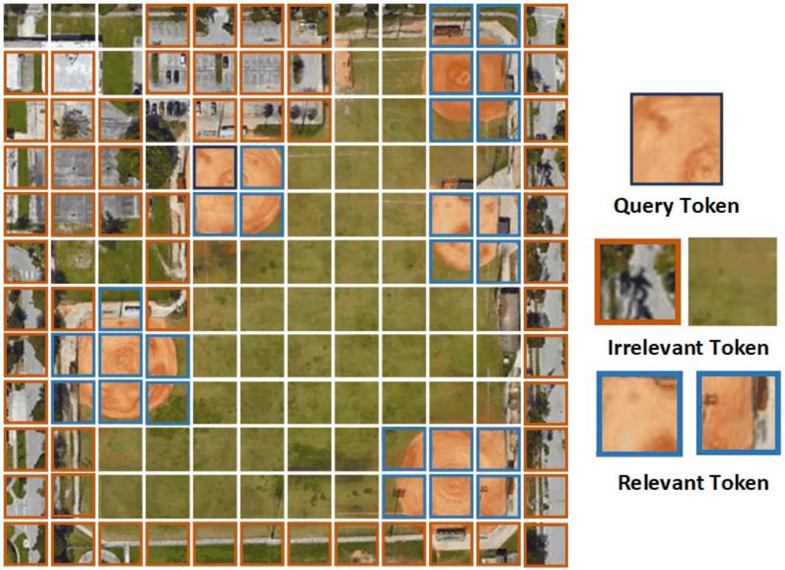
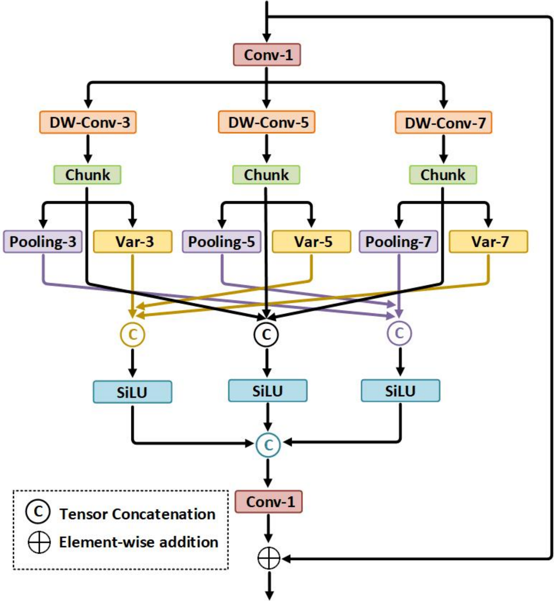
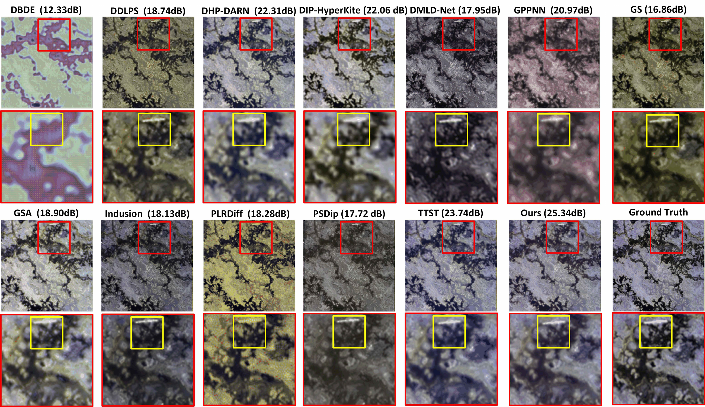
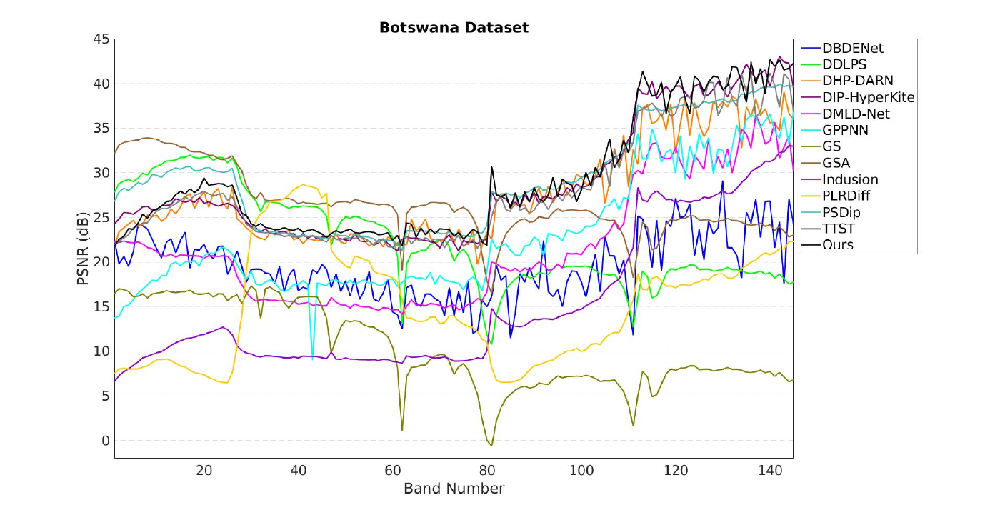
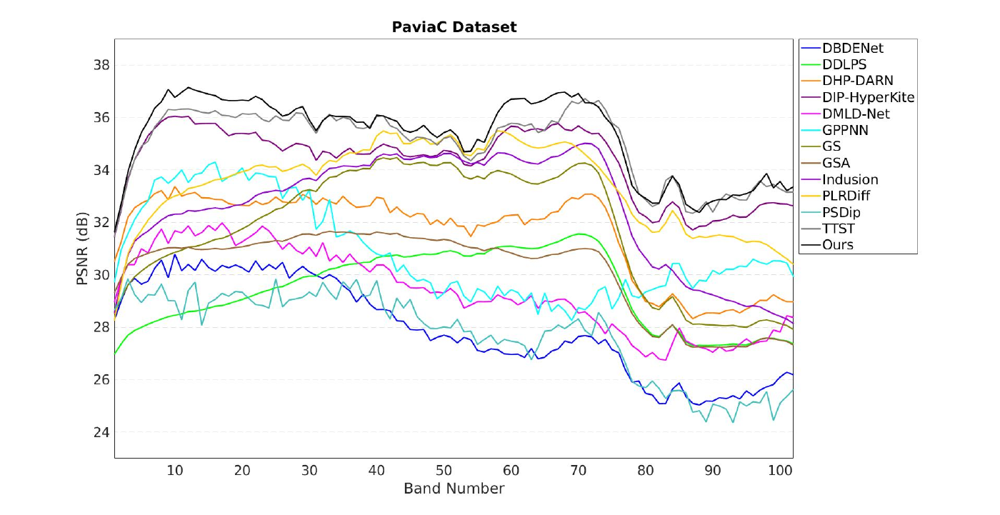
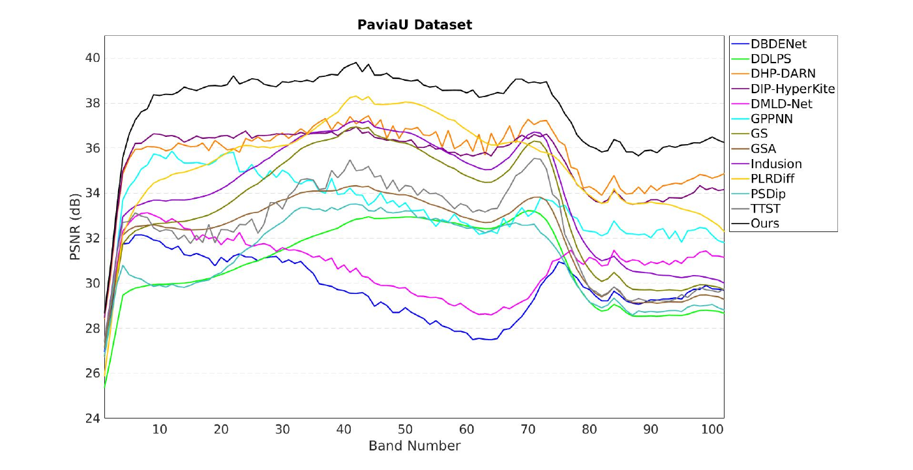

# Figure gallery

These images are rendered from the supplied figure PDFs for [THAT, IEEE SMC 2025](https://doi.org/10.1109/SMC58881.2025.11343459). Figure content and embedded annotations are retained. Experimental figures represent the paper's results, not a newly reproduced benchmark of this repository. The source mapping and checksums are available in [`assets/figures/sources.json`](../assets/figures/sources.json).

## Network architecture

Source: `PTST.pdf`. The paper diagram includes shallow fusion, PTSG stages, and reconstruction. Differences and ambiguous details resolved by this implementation are documented in [reproducibility notes](reproducibility.md).

## Pivotal relations and adaptive features

Source: `comparison.pdf`. Conceptual feature illustration from the paper; not an activation map computed from the current checkpoint.

## Token selection

Source: `example.pdf`. Paper illustration of token selection. It should not be interpreted as proof of the spatial-token layout of this implementation; the implemented attention uses channel-feature tokens.

## MVFN

  

Source: `MVFN.pdf`. Three depthwise-convolution paths combine direct, local-variance, and pooled features with SiLU, concatenation, projection, and residual addition.

## Botswana ×2: qualitative comparison

Source: `result.pdf`. Reconstruction views and enlarged regions for the compared methods, THAT (“Ours”), and ground truth. The dB labels belong to the supplied visualization; no new image-level or aggregate scores have been inferred from them.

## Botswana ×2: band-wise PSNR

Source: `Botswana_2_20_psnr.pdf`. Horizontal axis: spectral-band index. Vertical axis: PSNR in dB.

## PaviaC ×2: band-wise PSNR

Source: `PaviaC_2_20_psnr.pdf`. Horizontal axis: spectral-band index. Vertical axis: PSNR in dB.

## PaviaU ×2: band-wise PSNR

Source: `PaviaU_2_20_psnr.pdf`. Horizontal axis: spectral-band index. Vertical axis: PSNR in dB.
